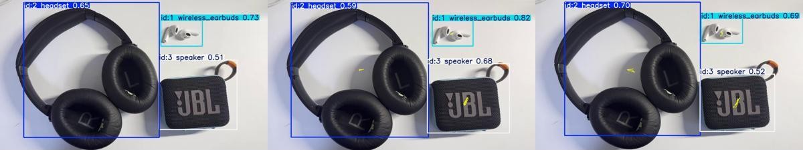

# 오디오 기기 3개 부류 객체 감지와 추적

머신러닝 과제: 헤드셋, 무선 이어폰, 스피커를 YOLOv8n으로 fine-tuning하고 직접 촬영한 영상의 첫 5초를 ByteTrack으로 추적했다.

## 제출 파일

- [학습 모델](best.pt)
- [5초 결과 영상](audio3_tracking_5s.mp4)
- [Word 보고서](YOLO_audio_report.docx)
- [테스트 지표](test_metrics.json)
- [추적 궤적 CSV](tracks.csv)
- [데이터 출처와 전처리](DATA_SOURCES.md)



## 실제 결과

로컬 RTX 5060에서 100 epochs, imgsz 640, batch 8, seed 42로 학습했다. 검증 성능으로 best.pt를 선택했다. test 126장의 mAP50은 0.8945, mAP50-95는 0.6571이다.

| 부류 | Precision | Recall | AP50 | AP50-95 |
|---|---:|---:|---:|---:|
| headset |0.9408|1.0000|0.9950|0.7400|
| wireless_earbuds |1.0000|0.6346|0.7700|0.4465|
| speaker |0.8677|0.8346|0.9186|0.7847|

audio3.mp4의 첫 5초(150프레임, 30fps)에 imgsz=1280, conf=0.4를 적용했다. 헤드셋은 148프레임(ID 2), 이어폰은 150프레임(ID 1), 스피커는 150프레임(ID 3)에서 추적됐다. 이는 출력이 존재한 프레임 수이며 정확도나 MOTA가 아니다. 영상 예시를 보고 임계값을 조정했으므로 이 영상은 독립 성능평가가 아닌 시연이다. 헤드셋 test 표본은 5장뿐이다.

## 실행

Python 3.12와 환경에 맞는 PyTorch를 준비한다. 학습에 사용한 버전은 torch 2.7.1+cu128, torchvision 0.22.1+cu128이다. CUDA 설치 방법은 https://pytorch.org/get-started/locally/ 를 참고한다.

```bash
pip install -r requirements.txt
python track.py --source audio3.mp4 --model best.pt --output runs/demo
python train.py --data /absolute/path/to/data.yaml
```

직접 촬영한 원본 영상은 별도로 준비한다. 재학습 데이터는 출처의 이미지를 내려받아 위 전처리와 같은 클래스 순서를 맞춰야 한다. data.yaml의 path를 실제 통합 데이터 폴더의 절대경로로 수정한다. 서로 다른 데이터셋을 기존 폴더에 덮어 풀지 않는다.

## 한계와 수정 과정

Colab에서 예전 2개 부류 폴더와 통합 데이터 폴더가 혼합되어 스피커 학습 자료가 빠지고 클래스 번호가 불일치하는 문제가 있었다. 새 폴더에 통합 데이터를 풀고 세 부류 존재 여부를 검사해 해결했다. 최종 모델은 정상 통합 데이터로 로컬 학습한 결과다.

이전 촬영 영상에서는 헤드셋 옆면을 스피커로 오분류하고 작은 이어폰을 놓쳤다. 새 영상에서는 물체가 크게 보이고 헤드셋 형태가 드러나 결과가 좋아졌다. 추가 촬영 환경에 대한 일반화 성능은 별도로 확인해야 한다.

Ultralytics 사용 조건: https://github.com/ultralytics/ultralytics/blob/main/LICENSE
공개 데이터 출처의 라이선스는 DATA_SOURCES.md를 참고한다.

저장소: https://github.com/spilleet/yolo-audio-detection
